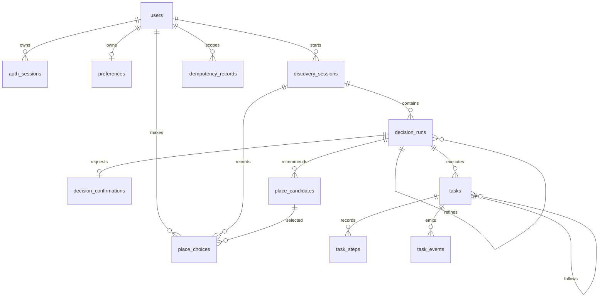

# 数据库表结构设计

本文依据 `src/backend/app/modules/*/models.py`、`src/backend/app/infrastructure/amap/models.py` 的 SQLAlchemy 模型和 `src/backend/migrations/versions/` 的 Alembic 迁移编写。所有表共用 `app/infrastructure/database/base.py` 的 ORM 基类，Alembic 在 `migrations/env.py` 中统一加载业务与缓存模型。当前设计包含 15 张应用表，使用 PostgreSQL；`alembic_version` 是 Alembic 的版本记录表，不属于应用表。

所有业务表都有 `id UUID` 主键，以及 `created_at`、`updated_at TIMESTAMP WITH TIME ZONE` 两个非空时间字段。主键和时间由 SQLAlchemy 在写入时生成或更新；迁移 SQL 没有给这些字段设置数据库端默认值。下文只列各表自己的字段。字段后的 `?` 表示允许 `NULL`；未标 `?` 的字段在迁移中均为 `NOT NULL`。模型中 `default=...` 也是应用端默认值，直接执行 SQL 插入时仍需显式提供必填字段。

## 关系总览

`place_cache`、`route_cache` 和 `auth_rate_limits` 没有外键。业务记录通过 `user_id` 或 `discovery_session_id → user_id` 归属用户；数据库外键保证记录存在，但跨表的“属于同一用户”校验仍由应用逻辑负责。

## 账号与认证

### `users`

用户账号的根表。其他用户私有数据直接或间接关联到它。

| 字段 | 类型 | 设计用途 |
| --- | --- | --- |
| `username` | `VARCHAR(32)` | 登录名；全局唯一。 |
| `display_name` | `VARCHAR(40)` | 显示名称。 |
| `password` | `VARCHAR(255)` | Argon2id 密码哈希，不存明文密码；字段名不表示可读取的密码。 |

约束：`UNIQUE (username)`；除主键外没有额外索引。

### `auth_sessions`

持久化登录会话，供请求认证与到期判断使用。一个用户可以有多条会话记录。

| 字段 | 类型 | 设计用途 |
| --- | --- | --- |
| `user_id` | `UUID` | 外键 → `users.id`，会话所属用户。 |
| `token_hash` | `VARCHAR(64)` | 会话令牌的哈希；全局唯一。 |
| `csrf_token` | `VARCHAR(64)` | 会话对应的 CSRF 校验令牌。 |
| `expires_at` | `TIMESTAMP WITH TIME ZONE` | 会话失效时间。 |

约束与索引：`UNIQUE (token_hash)`；`user_id` 有索引。过期记录不会由数据库自动删除。

### `auth_rate_limits`

保存认证请求的限流计数，独立于用户表，允许处理尚不存在的账号或来源。

| 字段 | 类型 | 设计用途 |
| --- | --- | --- |
| `key_hash` | `VARCHAR(64)` | 限流维度的哈希键；全局唯一。 |
| `window_started_at` | `TIMESTAMP WITH TIME ZONE` | 当前计数窗口的开始时间。 |
| `attempts` | `INTEGER` | 窗口内尝试次数；模型默认 `0`。 |

约束：`UNIQUE (key_hash)`；没有外键。

### `preferences`

用户长期保存的基础用餐偏好，每个用户最多一条，与一次选餐请求的条件区分开。

| 字段 | 类型 | 设计用途 |
| --- | --- | --- |
| `user_id` | `UUID` | 外键 → `users.id`；唯一，形成一对一关系。 |
| `preferred_cuisines`, `excluded_cuisines` | `JSONB` | 喜欢与排除的菜系列表；模型默认空列表。 |
| `disliked_places` | `JSONB` | 不喜欢的地点列表；模型默认空列表。 |
| `typical_budget_per_person_min?`, `typical_budget_per_person_max?` | `NUMERIC(10, 2)` | 常用人均预算区间。 |
| `typical_max_walking_minutes?` | `INTEGER` | 历史步行时长条件；保留旧值，新版本不再读写。 |
| `typical_radius_meters` | `INTEGER` | 常用直线搜索半径，模型默认 `2000`；新写入仅允许 `500 / 1000 / 2000 / 5000`。 |
| `preferred_tags` | `JSONB` | 常用标签列表；模型默认空列表。 |

约束：`UNIQUE (user_id)`，同时支持按用户查找偏好。

## 选餐与结果

### `discovery_sessions`

一次选餐会话的起点与原始条件。后续调整可以在同一会话下产生多个决策版本。

| 字段 | 类型 | 设计用途 |
| --- | --- | --- |
| `user_id` | `UUID` | 外键 → `users.id`，会话所属用户。 |
| `origin_latitude`, `origin_longitude` | `FLOAT` | 用户确认的出发点坐标。 |
| `origin_address` | `VARCHAR(200)` | 出发点文字地址；模型默认空字符串。 |
| `budget_per_person_min?`, `budget_per_person_max?` | `NUMERIC(10, 2)` | 本次人均预算区间。 |
| `max_walking_minutes?` | `INTEGER` | 历史步行时长条件；新会话不填写，保留旧值。 |
| `radius_meters` | `INTEGER` | 本次直线搜索半径；新请求仅允许 500、1000、2000、5000 米，默认 2000 米，历史其他半径仍可读取。 |
| `preferred_cuisines`, `excluded_cuisines`, `desired_tags` | `JSONB` | 本次菜系及标签条件；模型默认空列表。 |
| `meal_period` | `VARCHAR(32)` | 用餐时段。 |
| `party_size` | `INTEGER` | 用餐人数。 |
| `open_now_preferred` | `BOOLEAN` | 是否优先营业中的店；模型默认 `true`。 |
| `request_text` | `VARCHAR(300)` | 用户附加的自然语言需求；模型默认空字符串。 |
| `normalized_preferences` | `JSONB` | 解析、归一化后的条件快照；模型默认空对象。 |

索引：`user_id`。这张表保存会话条件，不保存最终餐厅列表。

### `decision_runs`

一次推荐计算及其状态。调整条件时创建新的决策记录，用 `parent_decision_id` 串起版本，而不覆盖旧结果。

| 字段 | 类型 | 设计用途 |
| --- | --- | --- |
| `discovery_session_id` | `UUID` | 外键 → `discovery_sessions.id`，所属选餐会话。 |
| `parent_decision_id?` | `UUID` | 自引用外键 → `decision_runs.id`，上一版决策。 |
| `workflow_version`, `prompt_version` | `VARCHAR(32)` | 生成结果时使用的工作流和提示词版本；模型分别默认 `5`、`2`。 |
| `status` | `VARCHAR(32)` | 决策状态；模型默认 `pending`。 |
| `refinement_action` | `VARCHAR(64)` | 产生本次调整的动作；初次决策默认为空字符串。 |
| `effective_preferences` | `JSONB` | 实际参与本次计算的偏好快照。 |
| `filter_summary` | `JSONB` | 候选过滤数量摘要。 |
| `excluded_place_keys` | `JSONB` | 本次排除的地点键列表。 |
| `provider`, `model_provider`, `model_name` | `VARCHAR(32)`, `VARCHAR(64)`, `VARCHAR(128)` | 地点提供方、模型提供方和模型名称。 |
| `llm_used` | `BOOLEAN` | 本次是否使用 LLM；模型默认 `false`。 |
| `duration_ms` | `INTEGER` | 执行耗时；模型默认 `0`。 |
| `error_code?` | `VARCHAR(64)` | 失败时的错误码。 |
| `completed_at?` | `TIMESTAMP WITH TIME ZONE` | 决策完成时间。 |

索引：`discovery_session_id`、`status`。`effective_preferences`、`filter_summary` 和 `excluded_place_keys` 在模型中分别默认空对象、空对象、空列表。

### `decision_confirmations`

硬约束变更需要用户确认时保存待确认内容及处理状态；每次决策最多一条。

| 字段 | 类型 | 设计用途 |
| --- | --- | --- |
| `decision_run_id` | `UUID` | 外键 → `decision_runs.id`；唯一。 |
| `changes` | `JSONB` | 待确认的条件变化；模型默认空对象。 |
| `status` | `VARCHAR(32)` | 确认状态；模型默认 `pending`。 |
| `resolved_at?` | `TIMESTAMP WITH TIME ZONE` | 确认或处理完成时间。 |

约束：`UNIQUE (decision_run_id)`。

### `place_candidates`

某次决策的餐厅候选及排序结果。记录服务商原始信息、路线、评分和解释的快照，便于历史回看。

| 字段 | 类型 | 设计用途 |
| --- | --- | --- |
| `decision_run_id` | `UUID` | 外键 → `decision_runs.id`。 |
| `place_key`, `external_place_id` | `VARCHAR(128)` | 应用内地点键与服务商地点 ID。 |
| `name` | `VARCHAR(150)` | 餐厅名称。 |
| `category_code`, `category_name` | `VARCHAR(64)`, `VARCHAR(200)` | 服务商分类；模型默认空字符串。 |
| `cuisine_types`, `tags` | `JSONB` | 菜系和标签列表；模型默认空列表。 |
| `address` | `VARCHAR(250)` | 餐厅地址；模型默认空字符串。 |
| `latitude`, `longitude` | `FLOAT` | 餐厅坐标。 |
| `straight_line_distance_meters` | `INTEGER` | 与出发点的直线距离。 |
| `walking_distance_meters?`, `walking_duration_seconds?` | `INTEGER` | 保留历史步行路线距离与耗时；新推荐不查询路线，这两列为空。 |
| `rating?` | `FLOAT` | 评分。 |
| `average_cost?` | `NUMERIC(10, 2)` | 人均消费。 |
| `business_status` | `VARCHAR(16)` | 营业状态；模型默认 `unknown`。 |
| `opening_hours_text?`, `phone?` | `VARCHAR(200)`, `VARCHAR(80)` | 营业时间文本和电话。 |
| `photos` | `JSONB` | 图片列表；模型默认空列表。 |
| `score` | `FLOAT` | 综合分；模型默认 `0`。 |
| `score_breakdown` | `JSONB` | 分项评分；模型默认空对象。 |
| `rank` | `INTEGER` | 本次决策中的排序名次。 |
| `reason` | `VARCHAR(600)` | 推荐理由；模型默认空字符串。 |
| `warnings` | `JSONB` | 未知或不满足的信息提示；模型默认空列表。 |
| `navigation_url?` | `VARCHAR(1000)` | 打开导航的链接。 |
| `route_snapshot?`, `place_snapshot` | `JSONB` | 路线和地点数据快照；地点快照模型默认空对象。 |

约束与索引：`UNIQUE (decision_run_id, rank)`、`UNIQUE (decision_run_id, place_key)`；`decision_run_id` 单列索引和 `(decision_run_id, score)` 复合索引。地点键只在同一次决策内唯一。

### `place_choices`

用户最终选择了哪个候选餐厅，供历史与反馈使用。

| 字段 | 类型 | 设计用途 |
| --- | --- | --- |
| `user_id` | `UUID` | 外键 → `users.id`，选择者。 |
| `discovery_session_id` | `UUID` | 外键 → `discovery_sessions.id`，关联选餐会话。 |
| `place_candidate_id` | `UUID` | 外键 → `place_candidates.id`，被选择的候选。 |
| `feedback` | `VARCHAR(300)` | 用户反馈；模型默认空字符串。 |
| `idempotency_key` | `VARCHAR(100)` | 创建选择记录时的幂等键。 |

约束与索引：`UNIQUE (user_id, idempotency_key)`；`user_id` 有索引。外键本身不会验证候选餐厅是否属于所填的选餐会话或用户。

## 持久化任务与 API 幂等

### `tasks`

工作流执行实例。应用用任务状态、租约和尝试次数管理异步执行、恢复与失败。

| 字段 | 类型 | 设计用途 |
| --- | --- | --- |
| `decision_run_id` | `UUID` | 外键 → `decision_runs.id`，对应的决策。 |
| `parent_task_id?` | `UUID` | 自引用外键 → `tasks.id`，前置任务。 |
| `kind` | `VARCHAR(32)` | 任务类型：`decision`、`refinement` 或 `resume`；模型默认 `decision`。 |
| `status` | `VARCHAR(32)` | 任务状态；模型默认 `queued`。 |
| `phase` | `VARCHAR(64)` | 当前工作流阶段；模型默认 `queued`。 |
| `request_id` | `VARCHAR(36)` | 对应请求标识；模型默认空字符串。 |
| `state` | `JSONB` | 工作流可恢复状态；模型默认空对象。 |
| `attempts` | `INTEGER` | 已尝试次数；模型默认 `0`。 |
| `lease_token?` | `VARCHAR(64)` | 当前执行者的租约令牌。 |
| `lease_until?` | `TIMESTAMP WITH TIME ZONE` | 租约截止时间。 |
| `error_code?`, `error_message?` | `VARCHAR(64)`, `VARCHAR(500)` | 失败信息。 |
| `started_at?`, `completed_at?` | `TIMESTAMP WITH TIME ZONE` | 开始、结束时间。 |

索引：`decision_run_id`、`status`、`(status, lease_until)`、`(decision_run_id, created_at)`。`status` 是字符串列，数据库未设置枚举或 `CHECK` 约束。

### `task_steps`

记录任务内各工作流步骤的执行状态摘要，用于审计。

| 字段 | 类型 | 设计用途 |
| --- | --- | --- |
| `task_id` | `UUID` | 外键 → `tasks.id`，删除任务时级联删除步骤。 |
| `key` | `VARCHAR(128)` | 步骤标识。 |
| `ordinal` | `INTEGER` | 步骤顺序号。 |
| `status` | `VARCHAR(32)` | 步骤状态；模型默认 `pending`。 |
| `attempts` | `INTEGER` | 已尝试次数；模型默认 `0`。 |
| `error_code?`, `error_message?` | `VARCHAR(64)`, `VARCHAR(500)` | 步骤失败信息。 |
| `started_at?`, `completed_at?` | `TIMESTAMP WITH TIME ZONE` | 开始、结束时间。 |

约束与索引：`UNIQUE (task_id, key)`、`UNIQUE (task_id, ordinal)`；`(task_id, status)` 复合索引。

### `task_events`

按任务保存事件序列，供进度流重放和断线恢复。

| 字段 | 类型 | 设计用途 |
| --- | --- | --- |
| `task_id` | `UUID` | 外键 → `tasks.id`，删除任务时级联删除事件。 |
| `sequence` | `INTEGER` | 同一任务内的事件顺序号。 |
| `event_type` | `VARCHAR(64)` | 事件类型。 |
| `payload` | `JSONB` | 事件数据；模型默认空对象。 |

约束与索引：`UNIQUE (task_id, sequence)`；`(task_id, sequence)` 复合索引。这两个结构覆盖相同字段，分别用于唯一性和显式查询索引。

### `idempotency_records`

保存写请求的幂等键、请求摘要和响应快照，使重复请求能够返回已有结果，并识别同一幂等键下的不同请求。

| 字段 | 类型 | 设计用途 |
| --- | --- | --- |
| `user_id` | `UUID` | 外键 → `users.id`，将幂等键限定在用户范围。 |
| `endpoint` | `VARCHAR(160)` | 接口标识。 |
| `idempotency_key` | `VARCHAR(100)` | 客户端提供的幂等键。 |
| `request_hash` | `VARCHAR(128)` | 请求内容摘要。 |
| `response_status` | `INTEGER` | 首次处理的 HTTP 状态；模型默认 `200`。 |
| `response_body` | `JSONB` | 首次处理的响应快照；模型默认空对象。 |
| `expires_at` | `TIMESTAMP WITH TIME ZONE` | 幂等记录到期时间。 |

约束与索引：`UNIQUE (user_id, endpoint, idempotency_key)`；`user_id` 有索引。到期记录需要应用或运维任务清理。

## 外部服务缓存

两张缓存表的 ORM 定义位于 `app/infrastructure/amap/models.py`；从业务模块移动至此未改变表名、字段或索引，不需要新增 DDL 迁移。缓存键包含接口、参数和 `v3` 版本，旧版本记录自然过期。`payload` 使用 `{payload, fetched_at}` 封装，高德响应中不插入采集时间；只写入经过校验和转换的成功结果。常规地点缓存默认 600 秒，路线 300 秒，空结果 30 秒。损坏内容视为未命中，数据库故障继续抛出。

### `place_cache`

缓存地点服务返回的数据，避免短时间内重复查询同一地点信息。

| 字段 | 类型 | 设计用途 |
| --- | --- | --- |
| `cache_key` | `VARCHAR(128)` | 查询缓存键；全局唯一。 |
| `provider` | `VARCHAR(32)` | 地点服务提供方；模型默认 `amap`。 |
| `payload` | `JSONB` | 缓存封装：地点响应 `payload` 和采集时间 `fetched_at`。 |
| `expires_at` | `TIMESTAMP WITH TIME ZONE` | 缓存失效时间。 |

约束与索引：`UNIQUE (cache_key)`；`expires_at` 有索引。过期数据不会由数据库自动删除。

### `route_cache`

缓存从出发点到目的地的路线结果，缓存键之外保留路线维度，便于排查和管理。

| 字段 | 类型 | 设计用途 |
| --- | --- | --- |
| `cache_key` | `VARCHAR(128)` | 路线缓存键；全局唯一。 |
| `origin_geohash` | `VARCHAR(32)` | 出发点的地理位置编码；模型默认空字符串。 |
| `destination_place_id` | `VARCHAR(128)` | 目的地的服务商地点 ID；模型默认空字符串。 |
| `travel_mode` | `VARCHAR(32)` | 出行方式；模型默认 `walking`。 |
| `payload` | `JSONB` | 缓存封装：路线响应 `payload` 和采集时间 `fetched_at`。 |
| `expires_at` | `TIMESTAMP WITH TIME ZONE` | 缓存失效时间。 |

约束与索引：`UNIQUE (cache_key)`；`expires_at` 有索引。过期数据不会由数据库自动删除。

## 迁移与当前状态

首次迁移版本为 `0001_user_accounts`，`down_revision = None`；`0002_timezone_aware_timestamps` 将三个原本不带时区的时间列改为带时区类型；`0003_simplify_workflow_state` 删除未使用的 Task 结果引用和步骤全量快照，并将升级前未完成任务标记为 `WORKFLOW_UPGRADED`。迁移不会由后端启动自动执行；在 `src/backend` 执行 `uv run alembic upgrade head` 会将 `DATABASE_URL` 指向的数据库更新至当前版本。执行前应确认目标连接配置。将迁移回退到 `base` 会删除全部 15 张业务表及其数据。

`0004_radius_recommendations` 新增常用半径并将已有偏好填充为 `2000`，允许历史会话的分钟字段为空，同时终止旧版本未完成任务及其待确认状态；已完成结果、旧分钟值和 JSON 快照保留。上线顺序为停止后端与 Worker、执行迁移、启动工作流 v5。读取旧快照时忽略分钟字段，不修改原始 JSON；旧半径不在四档内时，必须重新选择才可提交新推荐。降级不会恢复已终止任务；为恢复旧表的非空约束，降级会将 v5 创建会话的空分钟字段填为旧默认值 `15`，不会从半径换算分钟。
